# Celestron CGE → OnStepX conversion

I converted a used, classic Celestron CGE equatorial mount from its stock servo motors and hand-controller
electronics to stepper motors running [OnStepX](https://onstep.groups.io/g/main) on a FYSETC E4 board.
The mechanics are original; the drive and electronics are new. It now runs from my PC over Wi-Fi and
guides at under an arcsecond RMS.

<p align="center">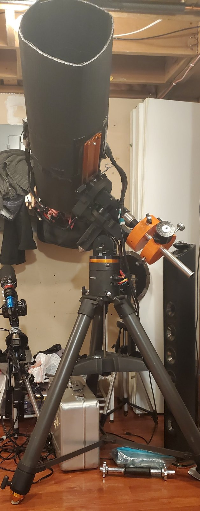</p>

This write-up covers why I did it, how I did it, the problems I ran into, and the numbers. If you're
rebuilding an old CGE yourself, I hope it saves you some time.

- [Where I started](#where-i-started)
- [Why the CGE, and what was wrong with it](#why-the-cge-and-what-was-wrong-with-it)
- [Teardown](#teardown)
- [New motors and drive train](#new-motors-and-drive-train)
- [Making the stepper fit](#making-the-stepper-fit)
- [Reassembly](#reassembly)
- [Electronics: OnStepX on a FYSETC E4](#electronics-onstepx-on-a-fysetc-e4)
- [Finishing touches](#finishing-touches)
- [Periodic error](#periodic-error)
- [How I use it](#how-i-use-it)
- [Results](#results)
- [What I'd do differently](#what-id-do-differently)
- [Reference: numbers and parts](#reference-numbers-and-parts)
- [Credits](#credits)

## Where I started

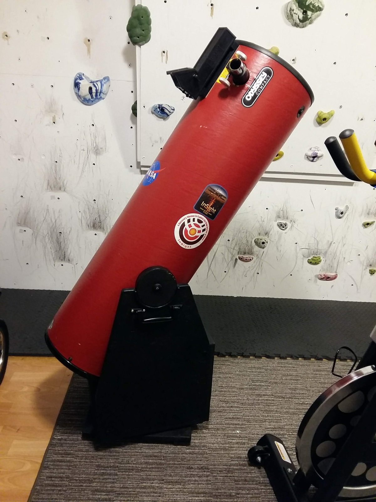

My first telescope was an old 10" Coulter Odyssey reflector. I converted it to go-to, with a motorized
focuser, using an OnStep controller on an Arduino Mega:

- **Home-made gears:** plywood circles with GT2 belts glued around the outside, teeth facing out. A
  spring-mounted stepper with a matching GT2 pulley pressed against each one.
- **Focuser:** another stepper, coupled to a sawed-off half of the focuser knob.
- **De-rotator:** a stepper driving a GT2 belt around a 2" field-rotator bearing, controlled by OnStep. It
  de-rotated the camera so I could take long exposures on an alt-az mount.

It worked relatively well, but the plywood circles weren't perfect, the gears sometimes skipped, and I
eventually found that the mirror had astigmatism. It was time for a "real" mount.

<br clear="right">

## Why the CGE, and what was wrong with it

I found a great deal on a used CGE: CAD 1,000. By my estimate, a new mount of the same class would be
about CAD 3,000, probably more now. (I also found a good deal on a used C8, but that's another story.)

The CGE is lovely and over-engineered. You can see the CNC machining marks, and the bearings look like
they belong in a car. But the stock electronics had two problems for me:

1. **No computer control.** The stock CGE only works from its hand controller. You can buy a USB adapter
   for the hand controller, but I wanted more features and stronger, more accurate motors.
2. **A dangerous cable design.** The pier and the mount head are joined by RJ (Ethernet-style) cables, and
   the stock design uses the cable *shielding* to carry the ground. If that connection breaks, a servo
   doesn't stop: it runs until it smashes into its limit. This is a known CGE failure; see
   [this write-up](http://www.astronomolly.com/2017/07/the-saga-of-celestron-cge-mount.html).

<p align="center">
  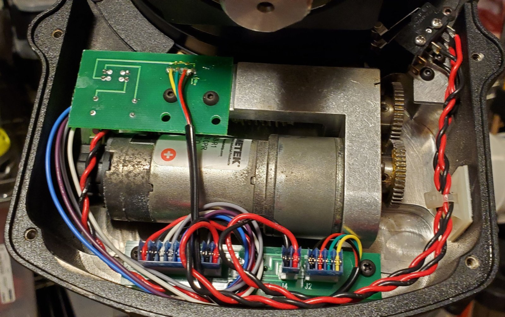
  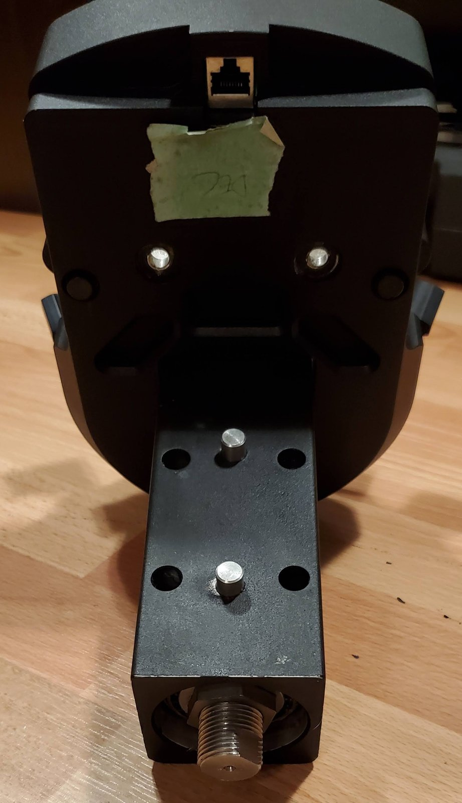
</p>
<p align="center"><em>Left: the stock servo, gearbox and encoder board. Right: the stock RJ connector.</em></p>

The stock motors are servos with gearboxes. I wanted precise steppers with precision planetary gearboxes
instead.

## Teardown

Since the mount was used and I was converting it anyway, I took it completely apart, cleaned and
re-lubricated everything, and put anti-seize compound on every bolt (steel bolts in an aluminum body).

<p align="center">
  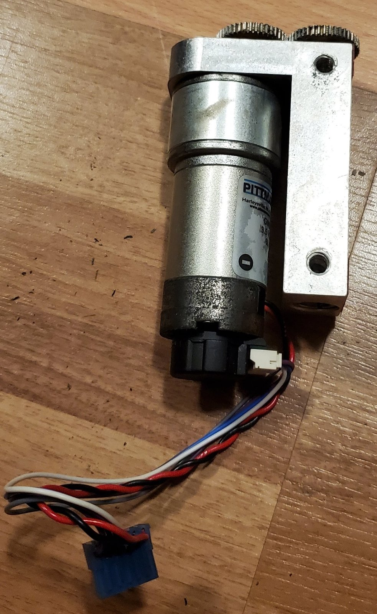
  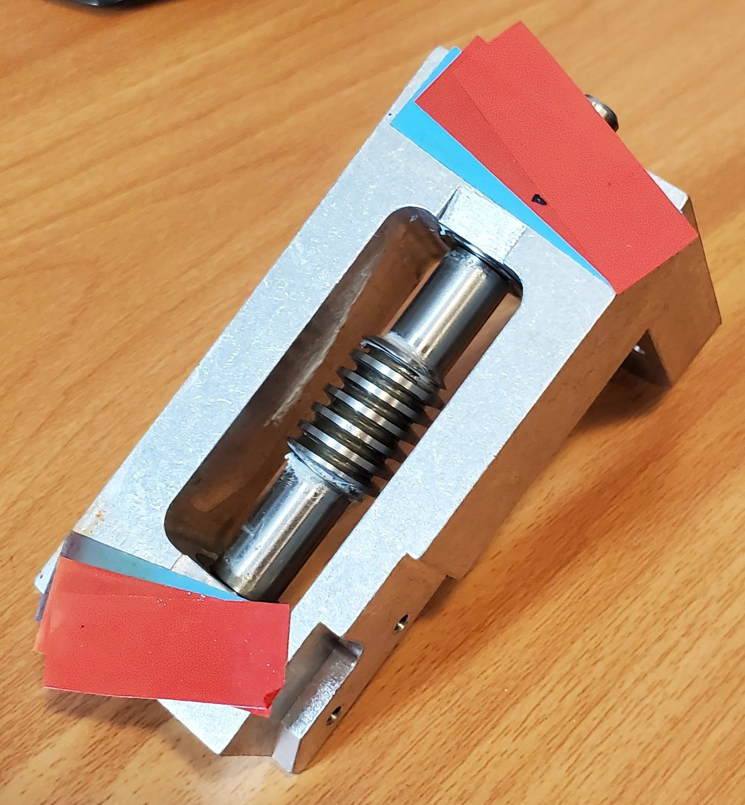
  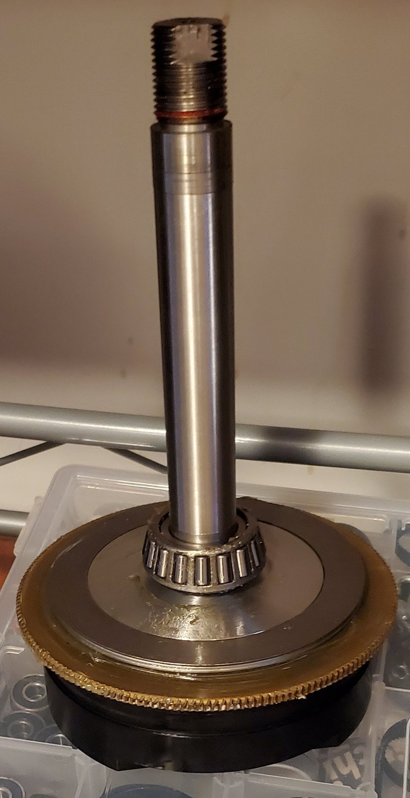
</p>
<p align="center"><em>The stock servo, gearbox and worm; the worm block with its backlash shims; an axis shaft
with the worm wheel and bearings.</em></p>

**Worm backlash** is a weak point of this mount: the worm doesn't float (it isn't spring-loaded against
the wheel). Backlash is set with thin plastic shims. I reused the stock ones.

The full axis teardown, step by step, is in the [gallery](gallery/README.md#bearing-and-axis-sequence).
It's a handy reference if you're taking apart the shaft, thrust bearing and clutch yourself.

## New motors and drive train

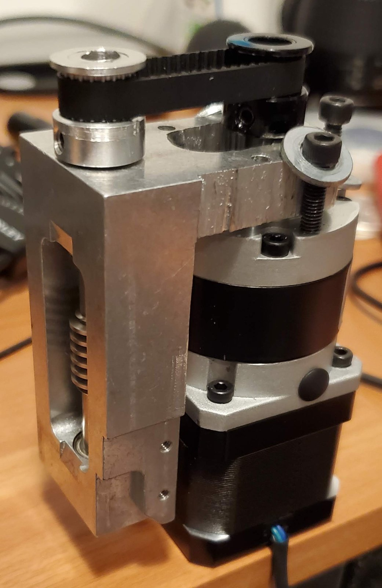

The motors are **StepperOnline NEMA 17 steppers (40 mm body) with 10:1 MG-series planetary gearboxes**
([17HS15-1584S-MG10](https://www.omc-stepperonline.com/nema-17-stepper-motor-l-40mm-gear-ratio-10-1-mg-series-planetary-gearbox-17hs15-1584s-mg10)).

The space set the design. The cavity size decided the motor size, and there was no room for large GT2
pulleys to get more reduction from the belt. So the reduction had to come from the motor: the 10:1
gearbox gives enough torque and accuracy for my slew speeds.

The full drive chain:

```
stepper → 10:1 planetary gearbox → 1.5:1 GT2 belt → worm → 180-tooth worm wheel
                                    overall reduction: 10 × 1.5 × 180 = 2700:1
```

I modified the stock servo bracket to take the stepper: the shaft hole had to be enlarged and offset.

<br clear="right">

## Making the stepper fit

The stepper and gearbox didn't fit in the stock motor cavity. I used a Dremel with a side-cutting end bit
to remove the excess aluminum. Then I tapped bolts into the sides of the cavity so I could press on the
sides of the stepper to center it and hold it in place.

<p align="center">
  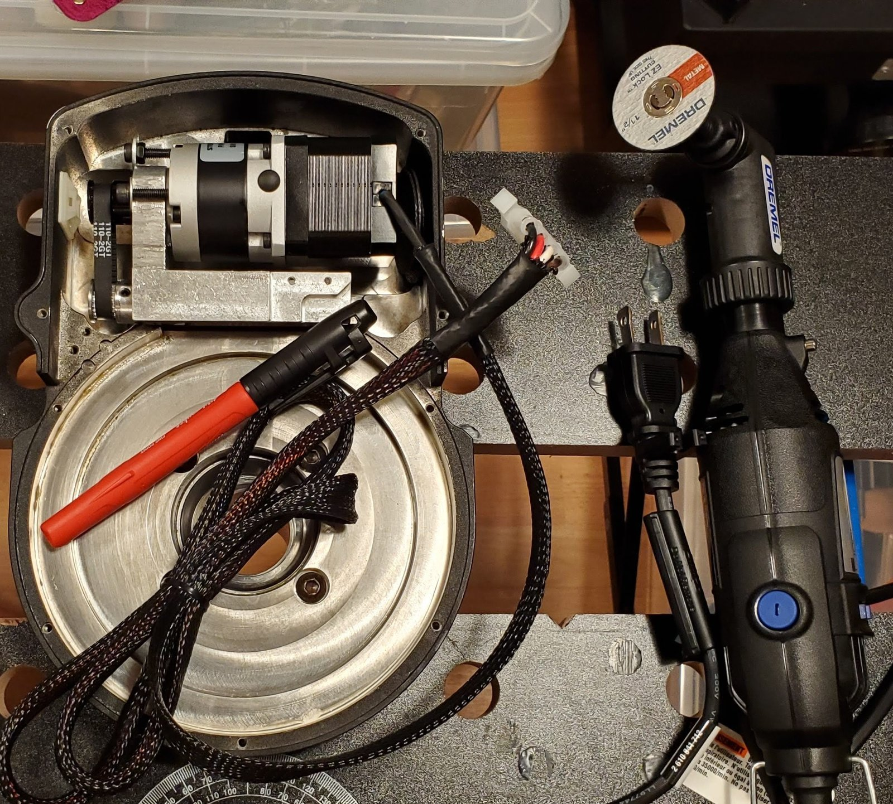
  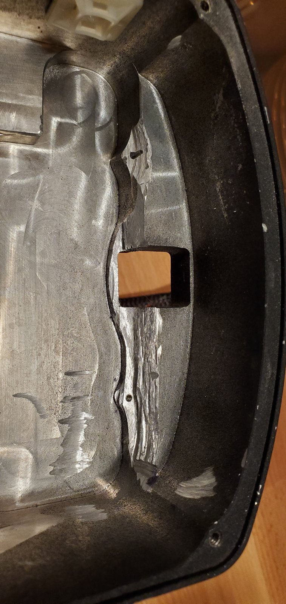
  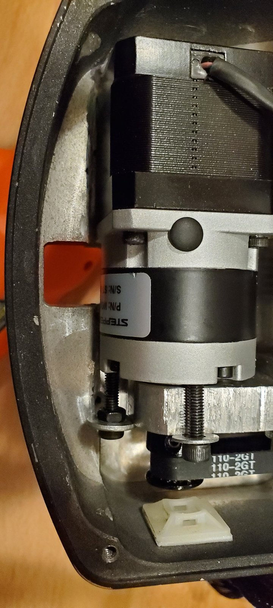
</p>
<p align="center"><em>Routing, the enlarged cavity, and the stepper fitted.</em></p>

I also enlarged the stock cable hole, epoxied in a plastic cable gaiter, and sealed it with silicone. The
measuring shots are in the [gallery](gallery/README.md#measuring-the-cavity).

## Reassembly

The limit sensors are the stock ones: a microswitch on each motor assembly. The E4 supports limit
switches out of the box, so I wired them straight in.

<p align="center">
  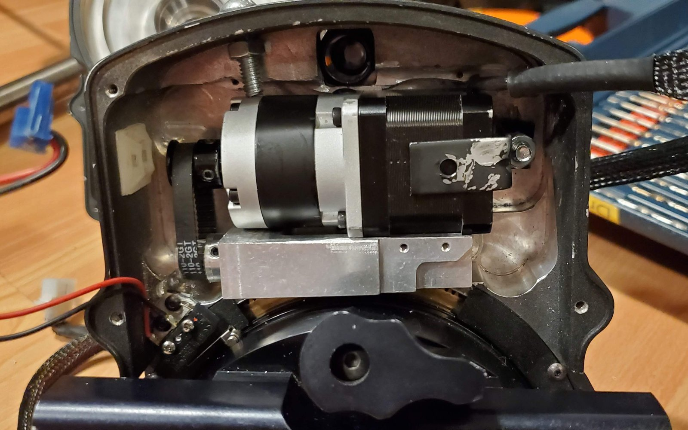
  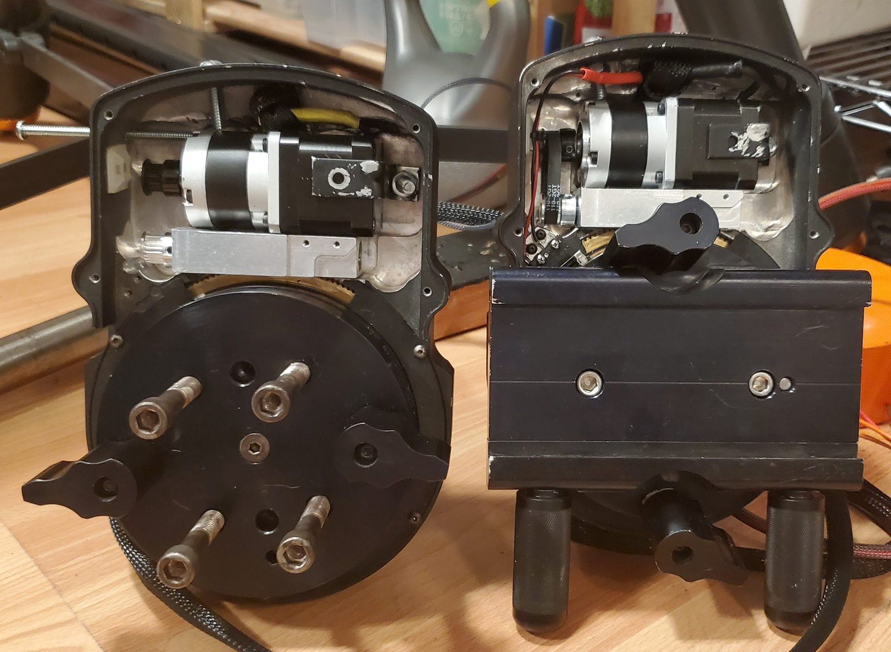
</p>
<p align="center"><em>A stepper wired in, next to the stock limit switch; the rebuilt RA and Dec assemblies.</em></p>

After the clean and re-lube, the axes turn very smoothly with the clutch disengaged:

https://github.com/user-attachments/assets/6cae568f-59e8-4dd9-8fbe-225d4e846e38

## Electronics: OnStepX on a FYSETC E4

While I was working on this, OnStepX added support for the FYSETC E4. That was great news. The E4 is an
all-in-one board, with the logic and stepper drivers (TMC2209) on one board. My old Mega-based OnStep
needed separate stepper driver modules, which tended to fail (or I burnt them out). OnStepX was also very
easy to configure on the E4, because all the pins are fixed. It has Wi-Fi built in.

**Heat sink.** After burning out drivers on the Odyssey, I didn't want to repeat it. I measured the
drivers' cooling area on the underside of the board and the height of the PCB risers. Then I cut a piece
of aluminum square bar and used thermal adhesive tape to bond the underside of the driver cooling pads to
the stock lower plate of the pier's enclosure, so the plate acts as the heat sink. I also used heat pipes
to couple that plate to the sides of the pier for more cooling area (I'm not sure how much that part
helps). There's been no overheating and no driver failures. The mount is well balanced and lubricated,
so the motors don't need much torque anyway.

<p align="center">
  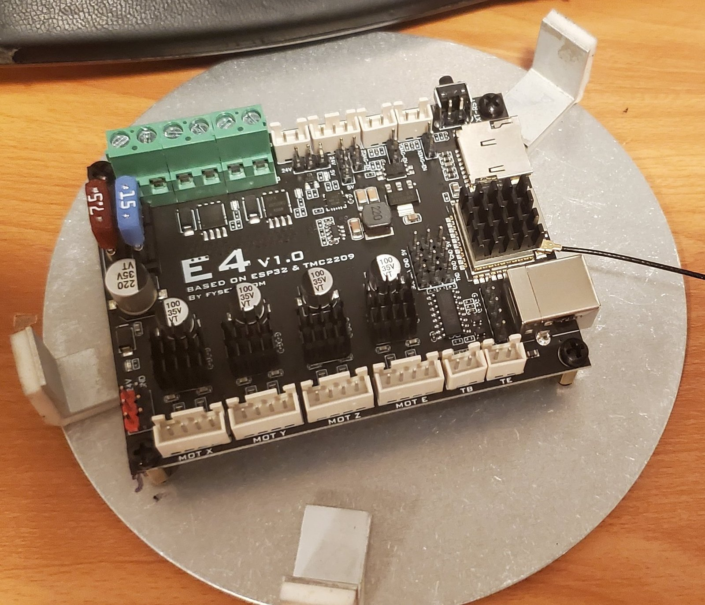
  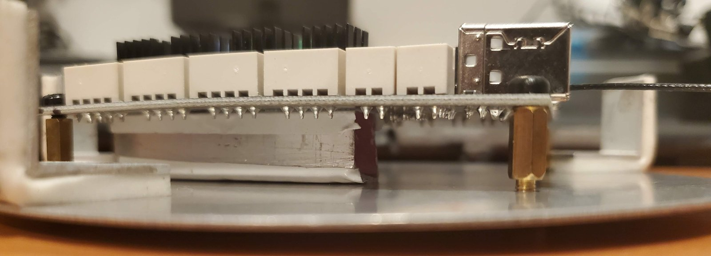
</p>
<p align="center"><em>The E4 on the stock base plate, and the aluminum bar under the drivers.</em></p>

**The pier.** I reused the stock cylindrical mini-pier, which had held the old controller, and its
existing holes. I enlarged the old cable ports and epoxied in larger Molex connectors. **Each motor now
has its own dedicated ground wire, so no cable shielding carries current**: that's the runaway problem
fixed. I added a panel-mount USB connector for flashing the firmware, and mounted the Wi-Fi antenna
connector on the outside.

<p align="center">
  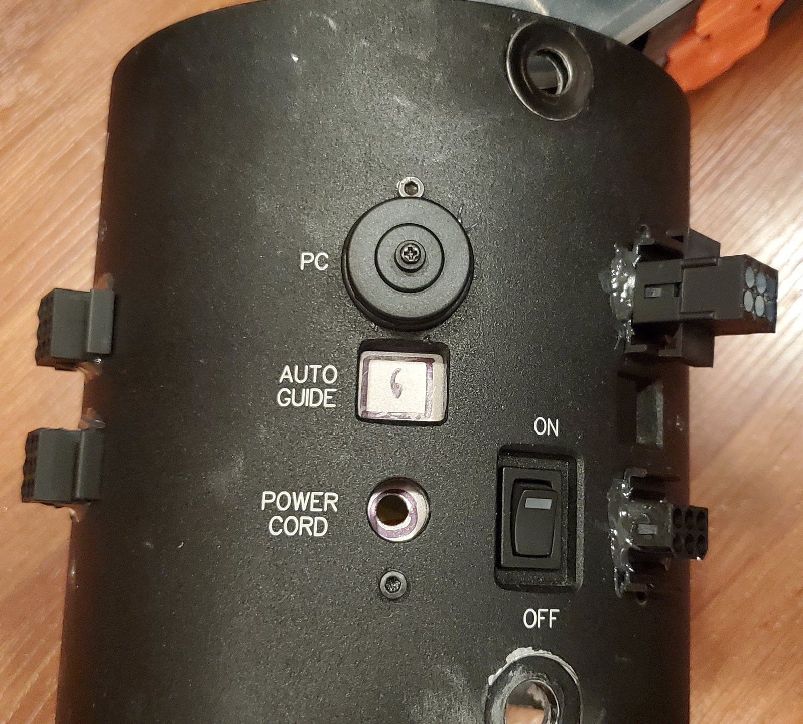
  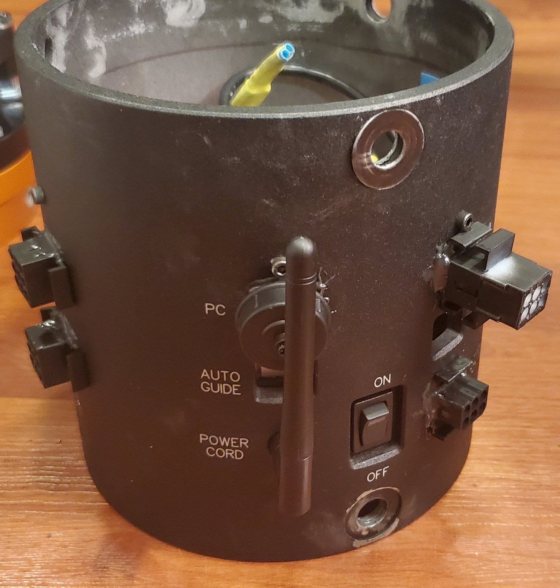
</p>
<p align="center"><em>The pier ports before and after.</em></p>

How I mounted the E4 inside the pier, messy wires and all, is in the
[gallery](gallery/README.md#mounting-the-e4-in-the-pier).

**Power** is 24V DC from my [PowerBox](https://github.com/mlemczyk/Telescope-Powerbox) project. Household
120V AC feeds a large 12V supply, and DC-DC converters give 5V for logic, 24V for the mount, and 12V for
the fans, dew heaters and cameras.

The E4 also drives my focuser: a small stepper on the telescope (my C8 or C11) that turns the focuser
through a GT2 belt and pulley.

## Finishing touches

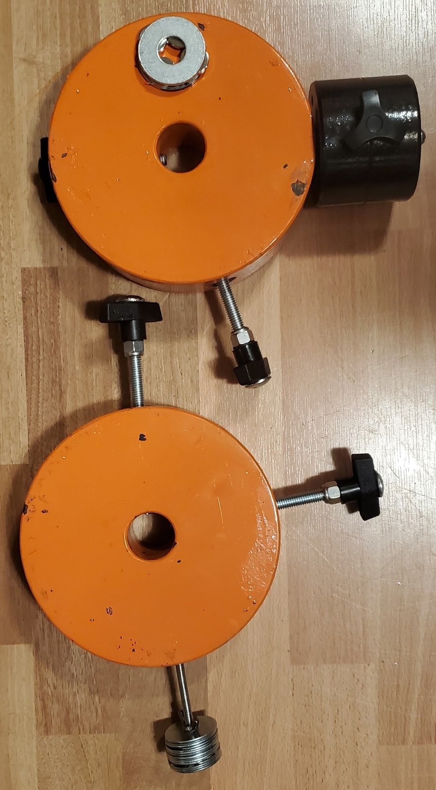

- **Counterweights:** cleaned and spray-painted orange to match. I drilled and tapped a second tightening
  screw, 90° from the stock one.
- **Balancing front to back with a low moment of inertia:** my telescope is rear-heavy. A weight on the
  front of the telescope would also make the scope side heavier, so the main counterweight would have to
  slide further out along the shaft to balance it. That raises the moment of inertia and puts more load
  on the motors. Instead, I added a small secondary counterweight (the black cylinder) on the "front" of
  the main counterweight. It balances the scope front to back, and because it sits on the counterweight
  side, the counterweights stay closer to the axis.
- **Handled bolts:** I made hand-turnable bolts to replace the stock tripod-to-mount bolts, so I can put
  the mount together and take it apart without tools.

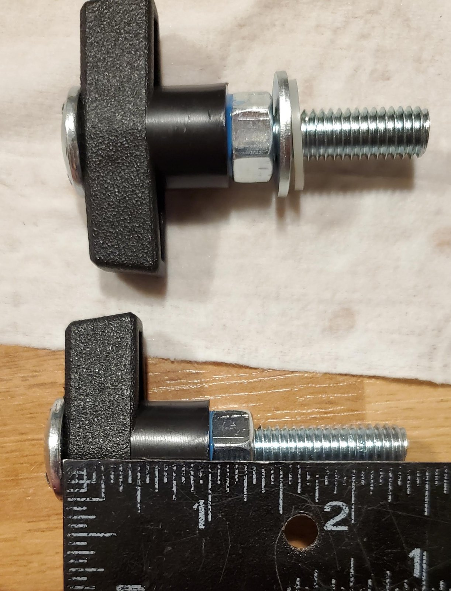

<br clear="right">

## Periodic error

The stock CGE has a PEC (periodic error correction) sensor. I measured its wiring to see whether I could
reuse it with the new controller, using schematics from an archive of the old CGE Yahoo Group. But the E4
didn't have enough spare inputs for it, so I dropped the idea.

Next I tried OnStepX's own PEC. At the time, training it meant driving the mount from Stellarium and then
re-importing a PEC curve, and I couldn't get it to work consistently.

What I use now is PHD2's **Predictive PEC** guide algorithm. It's lovely: it learns the periodic error
after a worm rotation or two, so there's no stored curve to go stale, and nothing breaks if something in
the mount shifts.

## How I use it

```
APT ──► OnStep ASCOM driver ──Wi-Fi (HTTP)──► OnStepX on FYSETC E4 ──► RA, Dec, focuser
PHD2 ──► guiding (Predictive PEC)
```

- The **OnStep ASCOM driver** talks to OnStepX over Wi-Fi.
- **APT** (Astro Photography Tool) controls the mount and the focuser.
- **PHD2** does the guiding.
- **Temperature:** I calibrated a thermistor with a two-point method (ice water and boiling water). OnStepX
  records the ambient temperature, and APT starts an autofocus run after a 2 °C change.
- **Guiding** uses an ONAG on-axis guider with an IR guide camera on the C8. Guiding through the main
  optics in infrared removes the effect of mirror flop or shifting in the SCT, and it made a huge
  difference.

## Results

The finished mount under OnStepX control, with the Dec stepper and belt driving the worm.

https://github.com/user-attachments/assets/81513d5f-1b53-4397-bdb9-5a5d6d1b556c

- **Guiding:** 0.88 arcsec total RMS (RA 0.80", Dec 0.36") on a good night. That's pretty good for sea level
  on the coast. The mount and the ONAG both get credit for it.

  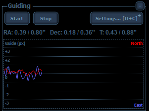

- **Payload:** my heaviest load is my planetary C11. No skipping.
- **Cost:** the conversion parts were relatively cheap: steppers, the E4 board, belts and pulleys.
- **Time:** a few months, and I enjoyed it. I also now know exactly how the mount works and how to fix
  any "finicky" behaviour.

## What I'd do differently

I'd spend a bit more time on appearance, such as cleaner silicone work on the outside. And I'd document
the process more thoroughly as I went, which is part of why this write-up exists.

## Reference: numbers and parts

**OnStepX settings for this build** (from my working `Config.h`):

| Setting | Value | Why |
|---|---|---|
| Steps per degree (both axes) | 48000 | 200 steps × 32 microsteps × 2700 ÷ 360 |
| PEC steps per worm rotation | 96000 | 48000 × 360 ÷ 180 teeth |
| Microsteps (tracking / slewing) | 32 / 2 | |
| Drivers | TMC2209 (on the E4) | |
| Motor current | 1024 mA | |
| Slew rate | 2.5°/s | |
| Limit switches | stock microswitches on the E4's X-MIN input | |

**Replacement bearing part numbers.** I researched these in case I needed them, but I didn't replace
any bearings, so they're untested. Measure yours before ordering.

| Bearing | Qty | Part number |
|---|---|---|
| Axis shaft tapered roller bearings | 2 | Timken IsoClass 30205M 9/KM1 |
| Worm wheel lower (main) thrust bearing | 1 | INA/FAG AXK90120 |
| Worm wheel upper thrust bearing | 1 | Timken/Torrington NTA-2031 |
| Worm bearings | 2 | SSRI814ZZ or R188ZZ |

## Credits

- [OnStep / OnStepX](https://onstep.groups.io/g/main): the open-source telescope controller firmware this
  build runs on. I configured it; I didn't write it.
- [*The saga of the Celestron CGE mount*](http://www.astronomolly.com/2017/07/the-saga-of-celestron-cge-mount.html)
  (astronomolly.com) for documenting the cable-shield ground problem.
- The archived CGE Yahoo Group, for the stock PEC schematics.

Released under [the Unlicense](LICENSE).
